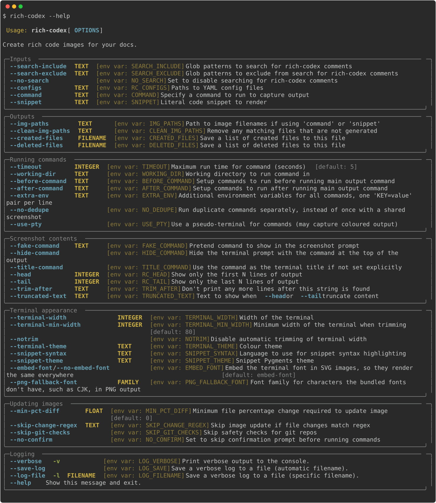
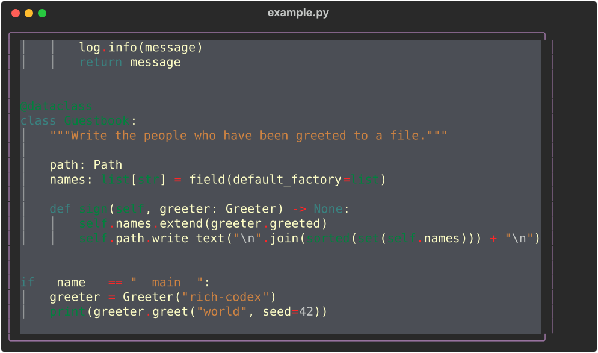

## Running commands

If you write markdown with images that contain _just_ a `backtick command` as the alt-text, rich-codex will find them.

For example, the following markdown will generate `../img/rich-codex-help.svg` (the image shown above) based on the output of the command `rich-codex --help`:

<!-- RICH-CODEX
terminal_width: 120
notrim: true
extra_env:
  TERMINAL_WIDTH: 120
-->

```markdown

```



## Printing files

You can use any command-line tool to print files for screenshots.
A good option is [rich-cli](https://github.com/Textualize/rich-cli), which you can use to easily produce screenshots of files with the `rich` command with nice syntax highlighting:

<!-- prettier-ignore-start -->
!!! tip
    You probably want to hide the command with `hide_command` - see below for more about configuration.

```markdown
<!-- RICH-CODEX hide_command: true -->

```
<!-- RICH-CODEX hide_command: true -->


!!! tip
    💡 Use the `--force-terminal` flag to keep colours in your screenshots

!!! note
    `rich-codex` used to bundle `rich-cli` as a requirement, but this was dropped in v1.2.7
<!-- prettier-ignore-end -->

## Title text

You can also add markdown image [title text](https://daringfireball.net/projects/markdown/syntax#img) in quotes after the filename, which will be used in the top menu bar of the screenshot terminal. (Alternatively, set the `title` config option in a comment).

This can be useful when adding lots of command markup to get a good screenshot.
You might also want to hide the command prompt.
For example:

<!-- prettier-ignore-start -->
```markdown
You don't always want people to see the exact command you used, after all.
<!-- RICH-CODEX hide_command: true -->

```
<!-- prettier-ignore-end -->



## Config comments

You can use a HTML comment in a line above the image to set config attributes for this image only.
The comment should begin with `RICH-CODEX` and then have valid YAML after that.

The parsed configuration will be validated - see an overview of available variables on the [config overview docs](../config/overview.md).

For example:

<!-- prettier-ignore-start -->

```markdown
<!-- RICH-CODEX {terminal_width: 60, terminal_theme: MONOKAI} -->

```

<!-- RICH-CODEX {terminal_width: 60, terminal_theme: MONOKAI} -->


<!-- prettier-ignore-end -->

## MDX files

Rich-codex searches both `.md` and `.mdx` files by default (see [`--search-include`](../config/overview.md)).

MDX (v2 and above, used by Docusaurus, Next.js and others) doesn't allow HTML comments, so config comments can also be written as JSX comments (`{/* … */}`):

<!-- prettier-ignore-start -->

```markdown
{/* RICH-CODEX {terminal_width: 60, terminal_theme: MONOKAI} */}

```

Multi-line config comments work in the same way, closing the block with `*/}`:

```markdown
{/* RICH-CODEX
terminal_width: 120
notrim: true
extra_env:
  TERMINAL_WIDTH: 120
*/}

```

!!! note
    The `RICH-CODEX` keyword must be on the same line as the opening `{/*`, just as it must be with `<!--`.

Both comment styles are recognised in every file that is searched, so you can use JSX comments in `.md` files and HTML comments in `.mdx` files if you prefer (though the latter won't compile as MDX).

<!-- prettier-ignore-end -->

## Code block output

Rich-codex can also run the command in a fenced code block and save its output as text, with the ANSI colour codes kept.
This is useful for docs sites that render ANSI colours in code blocks as HTML, such as Astro Starlight with the [starlight-codeblocks](https://github.com/ewels/starlight-codeblocks) plugin (version 1.4.0 or later, with `runnable.outputLang=ansi` on the code block).

Put a config comment directly above the code block. Rich-codex runs the code in the block as the command, and saves the output to a file, into the code block itself, or both.
Blank lines between the comment and the code block are fine, and the comment can be empty (`<!-- RICH-CODEX -->`) for inline output.

### Output to a file

Set `img_paths` in the config comment to one or more `.ansi` files, relative to the markdown file.
They hold the output as text with raw escape codes, so `cat` shows it in colour.
Rich-codex doesn't change the markdown file.

<!-- prettier-ignore-start -->

````markdown
<!-- RICH-CODEX
img_paths: [../img/checks-passed.ansi]
-->
```sh runnable.static runnable.outputLang=ansi runnable.outputFile="../img/checks-passed.ansi"
printf '\033[1;32m✓\033[0m All checks passed\n'
```
````

<!-- prettier-ignore-end -->

`.svg` and `.png` paths work here too, to get an image of the same output.

### Output into the code block

Put an `[!output]` marker line inside the code block.
Rich-codex runs the lines above the marker, and replaces everything between the marker and the closing fence (or an `[!output end]` line) with the output:

<!-- prettier-ignore-start -->

````markdown
<!-- RICH-CODEX terminal_width: 80 -->
```sh
printf '\033[1;32m✓\033[0m All checks passed\n'
# [!output]
\e[1;32m✓\e[0m All checks passed
# [!output end]
```
````

<!-- prettier-ignore-end -->

- The text before the marker (`#`, `//`, ...) doesn't matter, and anything after `[!output` inside the brackets is ignored, eg. `[!output lang=ansi]`.
- Colours are written as text with the escape character as `\e`, eg. `\e[33m`, so that they're readable in diffs. A literal `\e[` in the output is written as `\\e[`.
- The file is only rewritten when the output changes. `min_pct_diff` and `skip_change_regex` work as they do for images, to ignore changes such as timings. Code blocks without an `[!output]` marker or `img_paths` are left alone.
- Rich-codex won't write the output, and the run fails, if:
  - the code block has no closing fence or `[!output end]` line,
  - a line of the output would end the code block (a fence or `[!output end]`). Write it to a file instead.
  - the code block changed while rich-codex was running, for example because a command edited the markdown file.

### Options

- Set `command` in the config comment to run a different command from the one shown in the code block.
- The command line itself isn't printed, as the code block already shows it. Set `hide_command: false` to print it.
- All other config options, such as `terminal_width`, `head` and `extra_env`, work as they do for images.

## Code snippets

In addition to running commands, you can format code blocks or "snippets".

To do this, make the `<!-- RICH-CODEX` code comment config with the `snippet` key.
Remember that you can use the pipe character `|` in YAML to have multi-line strings, but you need to be careful with indentation to maintain valid YAML. I'd recommend you write the YAML in a code editor with syntax highlighting and then paste it in.

<!-- prettier-ignore-start -->

!!! info
    The alt-text for the markdown image embed doesn't matter for snippets. However, if it has a command in backticks then this will take priority over the snippet.

If the snippet is valid JSON, it will be pretty-printed and coloured. Otherwise text will default to white.

```markdown
<!-- RICH-CODEX
snippet: |
  {"menu": {
    "id": "file", "value": "File",
    "popup": {
      "menuitem": [
        {"value": "New", "onclick": "CreateNewDoc()"},
        {"value": "Open", "onclick": "OpenDoc()"},
        {"value": "Close", "onclick": "CloseDoc()"}
      ]
    }
  }}
-->

```


For other code languages, use `snippet_syntax` to define which language to format in. For example:

```markdown
<!-- RICH-CODEX
snippet_syntax: python
snippet: |
  >>> print("[italic red]Hello[/italic red] World!", locals())
  Hello World!
  {
      '__annotations__': {},
      '__builtins__': <module 'builtins' (built-in)>,
      '__doc__': None,
      '__loader__': <class '_frozen_importlib.BuiltinImporter'>,
      '__name__': '__main__',
      '__package__': None,
      '__spec__': None,
      'print': <function print at 0x1027fd4c0>,
  }
-->

```


<!-- prettier-ignore-end -->
